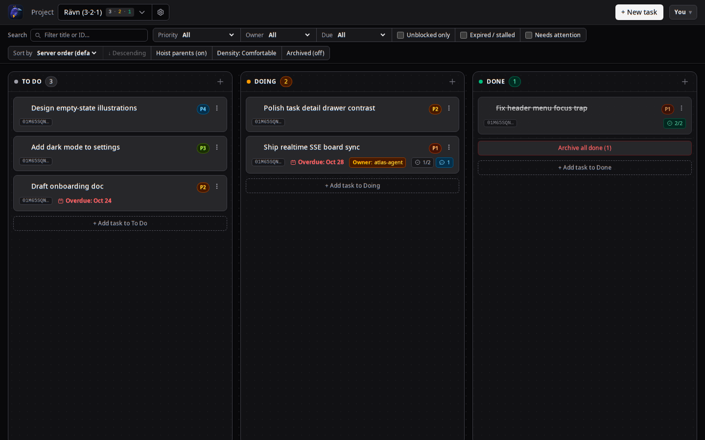

# Rävn

MCP-first, multi-project KanBan for humans and AI agents.



*The live Rävn board.*

## What it is

Rävn is an MCP-first KanBan tool where AI coding agents are the primary users. It serves as external memory (state survives session death), a coordination bus for multi-agent work (claims, handoffs, no duplicate work), and an evidence store (proof of done). The human web board is secondary. The backend is dependency-minimal Go in onion architecture with Docker-first deployment (main server + stateless MCP server containers) and pure-Go SQLite (no CGO). Authentication is optional and tiered: off (zero-config local), a single shared `RAVN_TOKEN`, or full multi-user mode with per-identity credentials, per-project membership scoping, and role gating — all opt-in via environment variables (see [Multi-user & authentication](#multi-user--authentication)).

## MVP features

- **Projects**: Create and manage projects with name and markdown description (doubles as agent onboarding doc).
- **Tasks**: Markdown title/description, priority (0-5), due date.
- **Workflow**: To Do / Doing / Done status transitions recorded as events.
- **Atomic claims**: Claim/release/heartbeat with TTL lease; CAS prevents duplicate grabbing; TTL expiry auto-heals zombie claims.
- **Typed assignee**: Durable ownership (human or agent identity) distinct from ephemeral claim.
- **Durable notes**: Replace-on-write resume context for fresh session survival.
- **Typed comments**: Progress / question / decision / handoff-note / note kinds with actor and timestamp.
- **Acceptance criteria**: Ordered checklist with optional completion notes.
- **Artifacts**: Typed evidence links (log / screenshot / command-output / trace / url / other) attached to tasks.
- **Relations**: Parent/child, blocked-by, duplicate-of, related edges; computed "blocked" flag; duplicate warnings on create.
- **Optimistic versioning**: Version-guarded writes with full activity log on every mutation.
- **Realtime events**: Per-project SSE streams; every mutation emits a typed event (the UI updates live, with a 15s poll fallback).
- **Auth (optional, tiered)**: off by default; shared `RAVN_TOKEN` bearer gates all `/api/v1/*` when set (`Authorization: Bearer …` or `?token=…` for SSE clients); or full multi-user mode with per-identity credentials and membership scoping (below).
- **Multi-user identity**: human + agent identities, password login sessions with TTL, per-agent API tokens, and operator provisioning endpoints; per-project membership (viewer/editor/admin) gates visibility and writes when enabled.
- **Observability**: `/healthz` liveness + in-memory metrics (Prometheus text or JSON) at `/metrics`.
- **Agent-first reads**: Filtered list_tasks (project/status/assignee/unblocked/search/date-range) with canonical sort and pagination; get_task returns one-call resume payload.
- **Minimal web UI**: Board columns by status plus task detail (notes, ACs, comments, artifacts), project settings, relations editor, and drag-and-drop status moves.
- **OpenCode dispatch**: Start an autonomous agent session per task via `POST /tasks/{id}/opencode/start` or the board launcher.
- **MCP tool surface**: 14 tools plus onboarding prompts and read-only task/project resources for agents to interact with the system.

## Architecture

- **Onion layering**: domain (stdlib only) → application (ports defined here) → infrastructure (SQLite driver, ULID) → interface/http (REST adapter) → mcp (MCP adapter).
- **Pure-Go SQLite**: No CGO via modernc.org/sqlite; fully static binaries with CGO_ENABLED=0.
- **MCP (dual transport)**: Stateless Streamable-HTTP via mark3labs/mcp-go v1.x over stdlib net/http (`/mcp`), plus legacy SSE (`/sse` + `/message`) with session fallback for pre-streamable clients.
- **Frontend**: Vite + TypeScript + Tailwind CSS v4 + Alpine.js, built at image-build time and served by the Go binary.
- **See [docs/ARCHITECTURE.md](docs/ARCHITECTURE.md)** for full technical details.

## Quick start

### Docker (recommended)

Requires Docker (with compose). Copy the env template only if you want to change defaults:

```bash
cp .env.example .env       # optional — every variable has a default
make up                    # starts ravn-server (:3311) + ravn-mcp (:9311) using Forgejo package
make build-up              # builds images from scratch locally and starts detached
make smoke                 # hits both /healthz + GET /api/v1/projects, prints PASS/FAIL
make logs                  # stream both containers' logs
make down                  # stop and remove containers (keeps the SQLite volume)
```

Older `docker-compose` (v1.x, Compose schema v3.3) can't parse the modern file — run `docker-compose -f docker-compose-v3.3.yml up` instead.

- **UI**: http://localhost:3311
- **API**: http://localhost:3311/api/v1 — full contract in [docs/API.md](docs/API.md)
- **MCP endpoint**: http://localhost:9311/mcp (onboarding for agents: [docs/MCP.md](docs/MCP.md))

**Port overrides.** Host-side published ports are env-overridable (`RAVN_SERVER_PORT`, default `3311`; `RAVN_MCP_PORT`, default `9311`). The containers always listen on 8080/9080 *internally* — only the host mapping changes, so the MCP→server upstream URL stays stable. If another process already owns the port you want, set e.g. `RAVN_SERVER_PORT=18080` in `.env` (do **not** kill what's there) and run `make up`; point UI/clients at http://localhost:18080.

**Persistence.** The SQLite database lives in the named Docker volume `ravn-data` (mounted at `/data`) and survives rebuilds and `make down`. To mount local host directories instead (e.g. `./data` and `./artifacts`), set `RAVN_DATA_DIR=./data` and `RAVN_ARTIFACTS_DIR=./artifacts` in `.env`. For backups see [Backups](#backups) below — do **not** copy the raw database file while the server is running.

### Direct binaries (development)

No Docker needed — build both statically and run them yourself:

```bash
make build                 # → bin/ravn-server + bin/ravn-mcp (pure-Go, static)
make ui                    # → web/dist (the built Vite UI)

./bin/ravn-server -addr=:3311 -data=./ravn.db -static=./web/dist &
RAVN_API_URL=http://localhost:3311 ./bin/ravn-mcp -addr=:9311 &
```

`-addr`, `-data`, `-token`, `-static` are the server flags, plus two one-shot ops modes that exit before any HTTP server starts: `-backup <path>` (hot backup of `-data` via `VACUUM INTO`) and `-integrity-check <path>` (`PRAGMA integrity_check` on any SQLite file). The MCP binary takes `-addr` plus env `RAVN_API_URL` (where the server lives), `RAVN_AGENT_NAME` (fallback actor name for calls that omit `actor`), and optional `RAVN_TOKEN` (forwarded upstream as a Bearer token). Verify with `curl http://localhost:3311/healthz` and `curl http://localhost:9311/healthz`.

**Optional auth.** Set `RAVN_TOKEN` in your environment or `.env` to enable shared-token auth: the server then requires it on every `/api/v1/*` route — `Authorization: Bearer <token>` or, for SSE/EventSource clients that cannot set headers, `?token=<token>` — answering `401` when absent or mismatched. `/healthz` and the web UI stay open either way. The MCP container forwards the same token on every upstream call, so agent tools keep working with no extra client config. For per-identity credentials and membership scoping instead of one shared token, see [Multi-user & authentication](#multi-user--authentication).

### Backups

ravn runs SQLite in **WAL mode**: while the server is live, data physically lives split across `ravn.db`, `ravn.db-wal` and `ravn.db-shm`, and the `-wal` file only folds into the main database on a clean checkpoint/shutdown. **Copying the raw `.db` (or naively copying all three files) from a running server can yield a corrupt or partial copy** — it is only safe after a graceful stop. Use one of these instead:

| Mechanism | When to use | Command |
|---|---|---|
| `scripts/backup.sh` (HTTP mode) | live server, zero downtime | `RAVN_API_URL=http://127.0.0.1:3311 [RAVN_TOKEN=…] sh scripts/backup.sh` (or `make backup`) |
| `scripts/backup.sh` (CLI mode) | local/dev DB file on this machine | `RAVN_DATA=./ravn.db sh scripts/backup.sh` — finds `./bin/ravn-server` automatically |
| one-shot CLI flag | scripting, containers | `ravn-server -data /data/ravn.db -backup /data/backups/snap.db` |
| admin endpoint | automation | `POST /api/v1/admin/backup` with `{"dest":"<absolute path>"}` (auth applies when `RAVN_TOKEN` is set) |

All four paths use SQLite's `VACUUM 'main' INTO '<file>'`: a consistent point-in-time snapshot written while the database keeps serving, producing a **single self-contained rollback-journal file with no `-wal`/`-shm` sidecars** — restore it by copying one file. Guarantees: destinations are restricted to a base directory (env `RAVN_BACKUP_DIR`, default `<data dir>/backups` — i.e. `/data/backups` on the volume in Docker), existing targets are **never overwritten** (`409` / exit 1), and `scripts/backup.sh` verifies every backup with `PRAGMA integrity_check` before printing `BACKUP OK`.

```bash
# live, zero-downtime backup (Docker or direct binary — adjust port)
make backup RAVN_API_URL=http://127.0.0.1:3311

# verify any SQLite file by hand
./bin/ravn-server -integrity-check ./ravn-backup-….db   # → "integrity_check ok: <file>", exit 0
```

## Multi-user & authentication

ravn ships three auth tiers, selected by **`RAVN_AUTH`** (`off` | `token` | `multiuser`). Every tier is opt-in and reversible — changing the env vars and restarting is the whole migration; no data format changes are ever required to go back.

| Tier | Behavior |
|---|---|
| **off** (default) | No auth. Declared free-form actors flow through exactly as in every pre-multi-user deployment. Zero-config local dev. |
| **token** (implicit when only `RAVN_TOKEN` is set) | One shared bearer token gates `/api/v1/*` and root `/metrics`. Requests act as the privileged *operator* (optionally acting-as a declared name). The historical default for LAN use. |
| **multiuser** | Each request's bearer resolves in strict order: shared operator token → password-login **session token** → per-agent **api_token**. Unresolvable/missing bearer → `401`. `POST /auth/login` is the only public route. |

On top of auth, **`RAVN_SCOPING=membership`** switches every list/read/write from see-all to *per-project membership* (viewer/editor/admin roles + owner), with role-gated task writes and admin/owner-gated membership management (`/projects/{id}/members`). It requires `RAVN_AUTH=token` or `multiuser` (with auth off, fail-closed scoping would lock out everyone, so the server refuses to boot). The authoritative variable reference — every accepted value, default, error behavior, and cross-knob rule — lives in [docs/ARCHITECTURE.md §9 Multi-user & authentication](docs/ARCHITECTURE.md#9-multi-user--authentication).

**First run (fresh install).** Enable multi-user, provision the first human account as operator, then give every agent its own api_token. **Upgrade of an existing deployment.** Everything is additive: the migration adds new tables only, `RAVN_SCOPING` stays `global` until you opt in, and `TestScoping_GlobalModeByteIdenticalToToken` pins that global mode is byte-identical to token-mode behavior. The full reversible rollout/hardening procedure (including rollback) is a runbook: [docs/RUNBOOK-multiuser.md](docs/RUNBOOK-multiuser.md).

```bash
# .env for a multi-user deployment (compose forwards all four knobs)
RAVN_AUTH=multiuser
RAVN_TOKEN=<operator-bootstrap-token>   # still honored in multiuser as the operator path
RAVN_SCOPING=membership                  # off until you're ready; global is the default
# RAVN_SESSION_TTL=24h                   # optional (Go duration; default 24h)
# RAVN_IDENTITY_OPEN=auto                # optional: auto (any authenticated user may create projects) | strict (operator only)
```

## MCP client config

An MCP client would point at the server over HTTP like this:

```json
{
  "mcpServers": {
    "ravn": {
      "url": "http://localhost:9311/mcp",
      "authentication": {
        "type": "httpHeader",
        "headers": {
          "Authorization": "Bearer <your RAVN_TOKEN, if auth is enabled>"
        }
      }
    }
  }
}
```

*Illustrative example — omit `authentication` when you run without `RAVN_TOKEN`; adjust to your client's format.*

When `RAVN_TOKEN` is set, the MCP server itself requires that token on every request to `/mcp`, `/sse`, and `/message`: send `Authorization: Bearer <token>` (or `?token=<token>` for SSE clients that cannot set headers), else you get `401`. Unset = no auth, keeping zero-config local dev.

## Documentation

- [docs/ARCHITECTURE.md](docs/ARCHITECTURE.md) — stack, onion layout, schema, API map, MCP design, Docker blueprint
- [docs/API.md](docs/API.md) — the durable REST wire contract (row shapes, error bodies, pagination, idempotency)
- [docs/MCP.md](docs/MCP.md) — agent onboarding: connection, actor convention, all 14 tools
- [docs/ROADMAP.md](docs/ROADMAP.md) — MVP scope (Tier 1) and the Tier 2/3 boundary
- [docs/RUNBOOK-multiuser.md](docs/RUNBOOK-multiuser.md) — reversible rollout/hardening runbook for enabling multi-user auth + membership scoping on a live deployment
